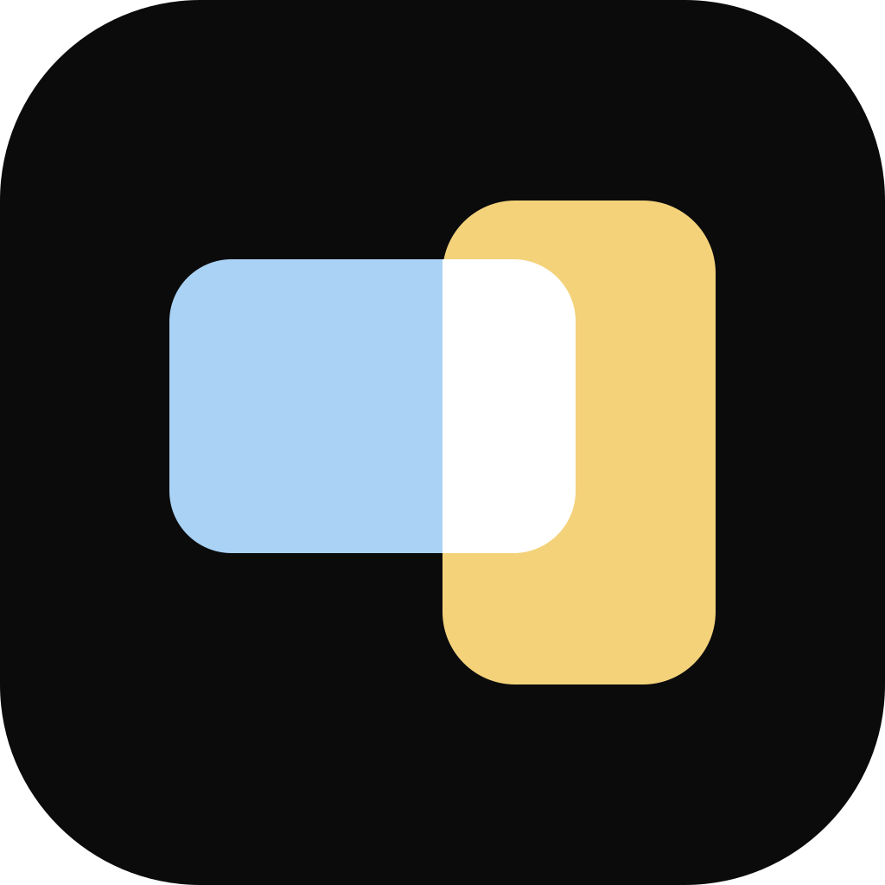
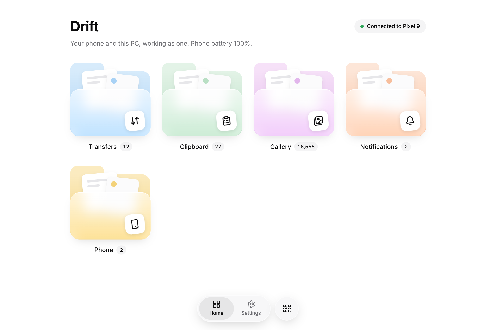
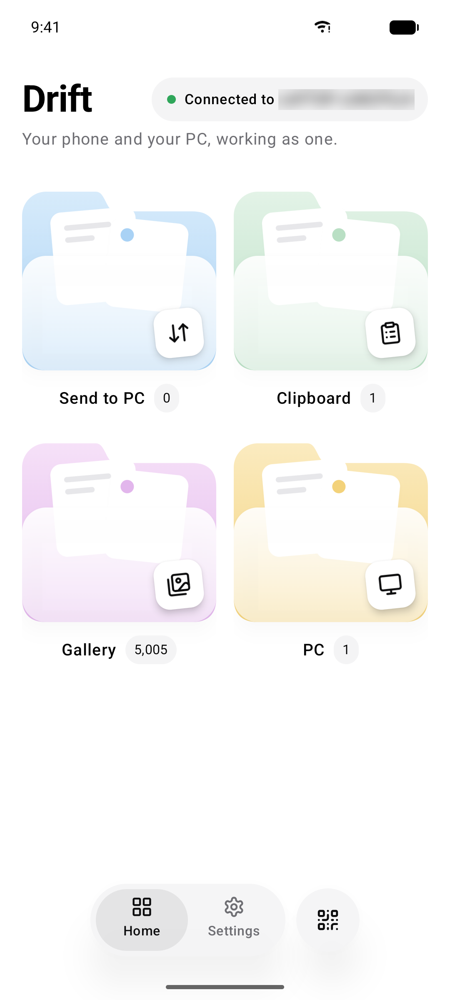
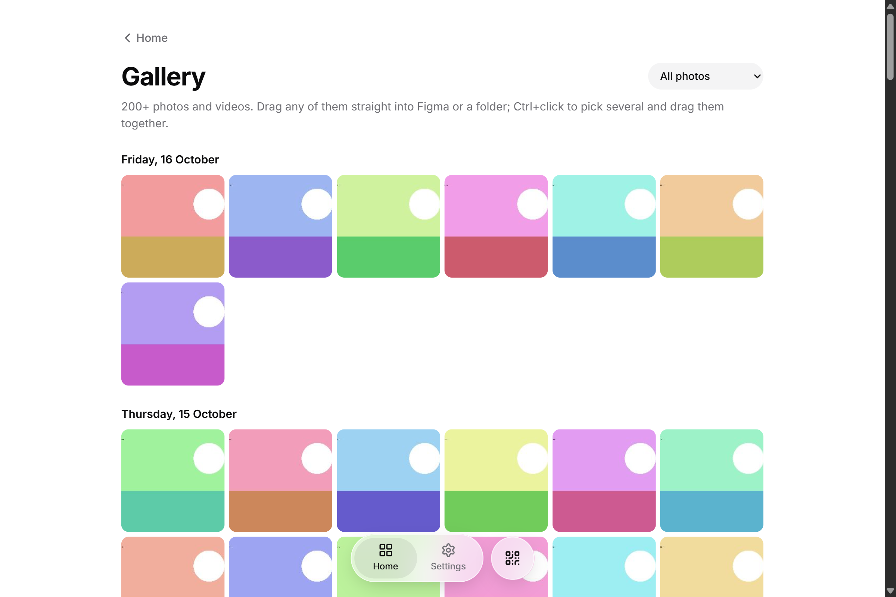
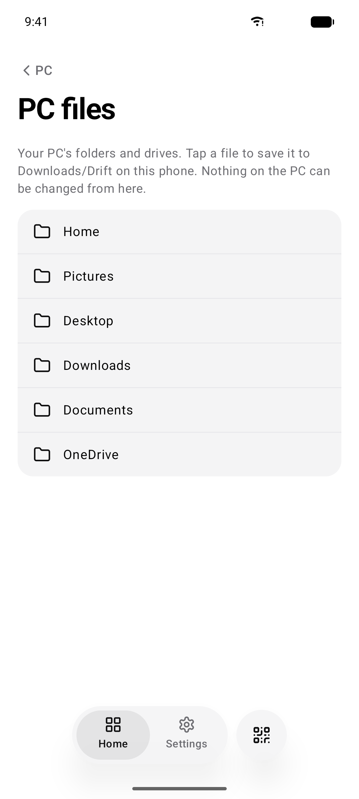
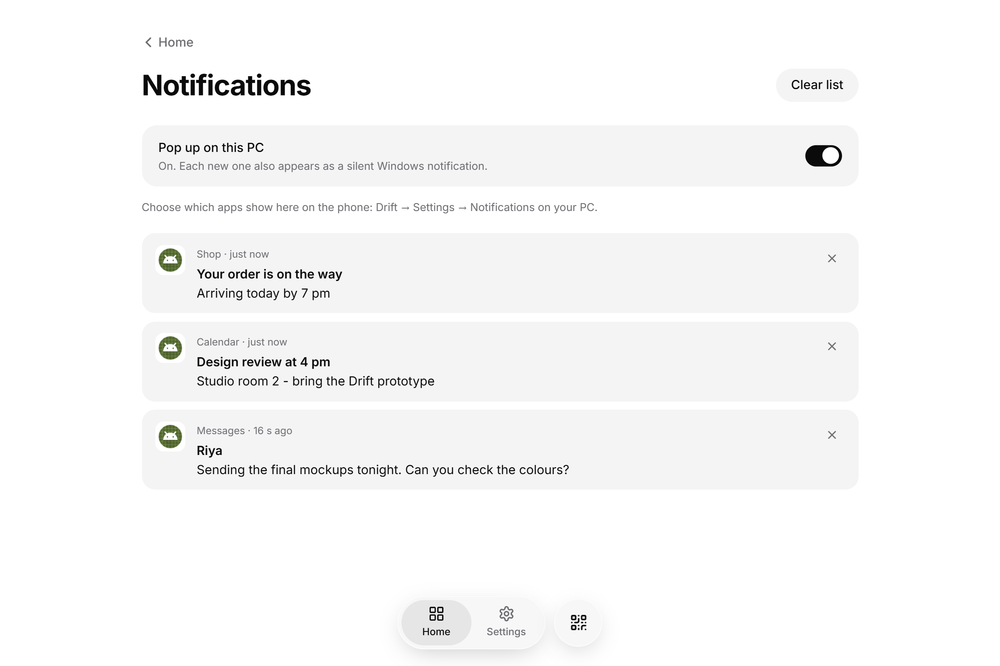
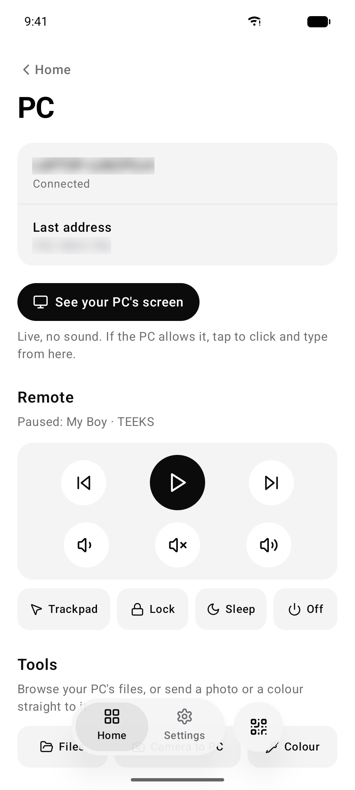
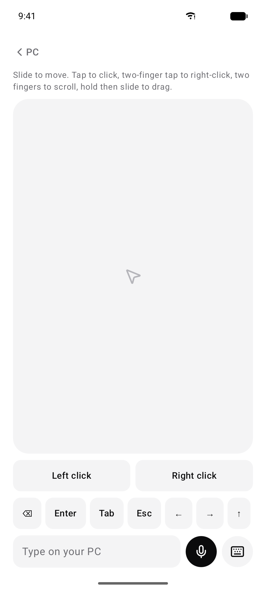
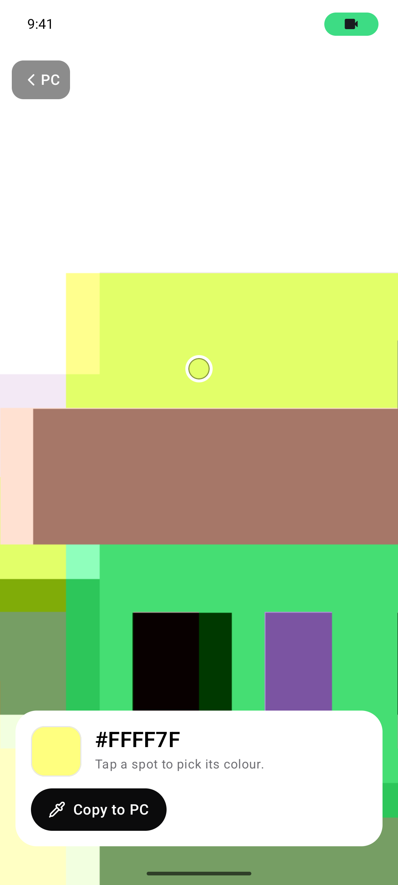
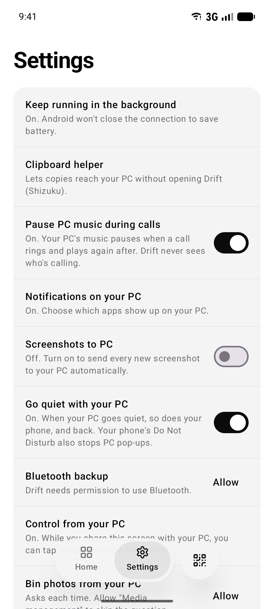

<p align="center">
  
</p>

<h1 align="center">Drift</h1>

<p align="center">
  <b>Your Android phone and your Windows PC, working as one.</b><br>
  Files, clipboard, photos, notifications, remote control and screen sharing.<br>
  Straight between your two devices, encrypted. No cloud, no account, no tracking.
</p>

<p align="center">
  <a href="../../releases/latest"><b>⬇ Download Drift 2.0</b></a> ·
  <a href="#features">Features</a> ·
  <a href="PRIVACY.md">Privacy</a> ·
  <a href="https://www.instagram.com/byte.sizedesign/">Made by @byte.sizedesign</a>
</p>

<p align="center">
  
  &nbsp;
  
</p>

---

## Download

| | File | Needs |
|---|---|---|
| **Phone** | `Drift-2.0.0.apk` | Android 10 or newer |
| **PC** | `Drift_2.0.0_x64-setup.exe` | Windows 10 (1809+) or Windows 11, 64-bit |

Get both from the **[latest release](../../releases/latest)**. Both are free.

**Install on your PC:** run the setup file. It installs just for you, so no admin password is needed.
Windows may say *"Windows protected your PC"* because Drift is a new app from an independent
maker. Click **More info → Run anyway**.

**Install on your phone:** open the APK on your phone and allow *"Install unknown apps"* for your
browser or file manager when Android asks. (Drift isn't on the Play Store yet.)

**Connect them:** open Drift on the PC and click the QR button. Scan it with Drift on the phone,
then click **Allow** on the PC. That's it: from now on they find each other by themselves.

<details>
<summary>Check the download wasn't tampered with (optional)</summary>

Each release lists SHA-256 checksums in `SHA256SUMS.txt`. In PowerShell on your PC:

```powershell
Get-FileHash .\Drift_2.0.0_x64-setup.exe -Algorithm SHA256
```

The result should match the line in `SHA256SUMS.txt`.
</details>

---

## Features

### Files, clipboard and photos

- **Send files both ways.** Drag onto the PC window, or Share → Send to PC on the phone. Big files resume after a dropped connection.
- **Copy on one, paste on the other**, in about a second: text, links and images. Password-manager copies are never sent.
- **Your phone's gallery on the PC.** Browse by album, view full size, or drag photos straight into Figma or Explorer.
- **Screenshots and camera to PC.** New phone screenshots, or photos you take in Drift, land in a PC folder automatically.
- **Browse your PC's files from the phone**, read-only. Off until you turn it on.

<p align="center">
  
  &nbsp;
  
</p>

### Notifications and calls

- **Phone notifications on the PC**, silent, with quick reply. You choose which apps show up.
- **Music pauses for calls.** Spotify and YouTube on the PC pause when your phone rings and play again after.
- **Focus sync.** When the PC is on Do not disturb or you're presenting, the phone goes quiet too, and the other way round.
- **Find my phone** rings at full volume, even on silent. Phone battery and "download finished" alerts show on the other device.

<p align="center">
  
</p>

### Control your PC from the phone

- **Media remote:** play/pause, skip, volume, and what's playing.
- **Trackpad and keyboard**, plus voice typing into whatever is open on the PC.
- **Lock, sleep or shut down** the PC (the phone asks first). **Wake it** from sleep on your home network.
- **Open PC apps**, or a one-tap set like "Work mode" (Figma + Chrome + Spotify). Only apps you approve on the PC can be opened.
- **See your PC's screen** live on the phone, with pinch to zoom. And your phone's screen on the PC.

<p align="center">
  
  &nbsp;
  
  &nbsp;
  
</p>

### Made for designers

- **Camera colour picker.** Point the phone at anything, tap, and the hex code lands on your PC's clipboard.
- **Colour clipboard.** Copied hex codes show as swatches and build a palette on both devices.
- **Searchable clipboard history** of your last 200 copies, on both devices.

### Works anywhere

- **At home** over Wi-Fi, with Bluetooth as a backup for clipboard, calls and notifications.
- **Away from home** over mobile data with [Tailscale](https://tailscale.com) on both devices (free for personal use).

---

## Privacy

Drift was built so you never have to trust a server, because there isn't one.

- **Your data only goes between your own two devices.** Nothing passes through the internet or a cloud.
- **Only your paired devices can connect.** Every connection is encrypted, and both sides check each other's certificate.
- **No accounts, no ads, no analytics, no tracking.** The phone app has no Google or third-party reporting libraries.
- **Safe defaults.** Screen control, trackpad and file browsing stay off until you switch them on, on the PC.
- **Private PC folders** (AppData, Drift's own keys) can never be browsed from the phone.
- **Files from the phone carry Windows' safety mark**, so Windows warns before running a received program.
- **Nothing is backed up to the cloud** or copied to a new phone.

<p align="center">
  
</p>

**[Read the full safety & privacy report →](PRIVACY.md)**: what was tested, what was found, and what was fixed.

---

## About

Drift is designed and built by **Tanish Kumar**, a designer.

- Instagram: **[@byte.sizedesign](https://www.instagram.com/byte.sizedesign/)**. Say hi, share how you use Drift, or ask for a feature.
- Found a bug? [Open an issue](../../issues/new) with what you did, what you expected and what happened.
  On the PC, *Settings → Copy logs* gives you a log to paste in (it never contains your clipboard or messages).

Drift is free to download and use. The source code is not public. See [LICENSE](LICENSE.md).

© 2026 Tanish Kumar. "Drift" and the Drift logo belong to Tanish Kumar.
